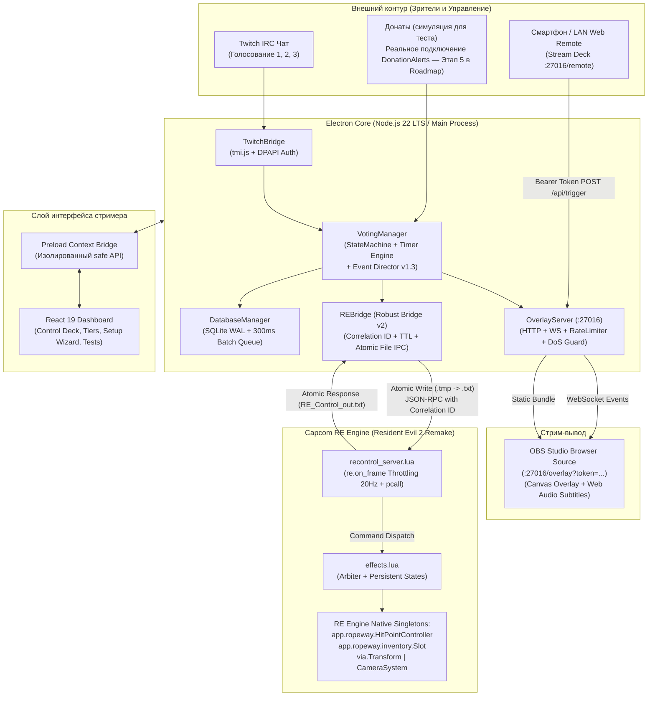

<div align="center">
  

  # RE:CONTROL
  ### Интерактивная стрим-интеграция и Crowd Control движок для Resident Evil

  <p align="center">
    <strong>Превратите зрителей трансляции в режиссёров хаоса. Управляемого хаоса — как и подобает корпорации Umbrella.</strong>
  </p>

  <p align="center">
    <a href="https://github.com/Djoystick/RE-Control/releases"></a>
    <a href="https://www.electronjs.org/"></a>
    <a href="https://react.dev/"></a>
    <a href="https://www.typescriptlang.org/"></a>
    <a href="https://vite.dev/"></a>
    <a href="https://tailwindcss.com/"></a>
    <a href="https://github.com/praydog/REFramework"></a>
    <a href="https://www.sqlite.org/"></a>
    <a href="LICENSE"></a>
  </p>

  <p align="center">
    <a href="#-особенности">Особенности</a> •
    <a href="#-скриншоты">Скриншоты</a> •
    <a href="#-архитектура-системы">Архитектура</a> •
    <a href="#-игровые-механики-re-engine">Механики RE Engine</a> •
    <a href="#-матрица-эффектов">Матрица эффектов</a> •
    <a href="#-директор-ивента-adaptive-pacing">Директор ивента</a> •
    <a href="#-чат-команды-бота">Чат-команды</a> •
    <a href="#-безопасность-и-харденинг">Безопасность</a> •
    <a href="#-установка-и-запуск">Установка</a> •
    <a href="#-дорожная-карта">Roadmap</a>
  </p>
</div>

---

## 📖 О проекте

**RE:CONTROL** — это настольное приложение на базе Electron, React 19 и REFramework, связывающее Twitch-чат и мобильные устройства с игровым движком **Capcom RE Engine** (Resident Evil 2 Remake). Начиная с v1.3.0 в состав входит **Директор ивента** — адаптивный движок пейсинга, который следит за вовлечённостью чата и балансом эффектов, превращая поток случайного хаоса в поставленное шоу. Поддержка донатов DonationAlerts находится в разработке (Этап 5 в Roadmap); сейчас донатные сценарии доступны через встроенный симулятор для теста.

В отличие от стандартных решений, эмулирующих клавиатурные нажатия или макросы, RE:Control производит **прямое низкоуровневое взаимодействие с памятью игры и классами синглтонов** в реальном времени. Зрители голосуют за положительные, отрицательные и психологические эффекты, вызывают вмешательства Амбреллы, а стример может управлять процессом со смартфона через локальный Web Remote Stream Deck без сворачивания игры.

---

## ✨ Особенности

- 🎮 **Нативное управление памятью RE Engine:** Прямой доступ к синглтонам `app.ropeway.HitPointController`, `app.ropeway.inventory.Slot`, `via.Transform` и `CameraSystem` через REFramework Lua API.
- ⏱️ **Арбитраж эффектов времени и камеры:** Встроенный арбитр исключает конфликты и гонки состояний (`freeze > slow_down > speed_up`, `fov_narrow > fov_wide`), корректно возвращая базовые параметры движка.
- 📱 **Мобильный Web Remote (Stream Deck):** Автономный HTTP-сервер на порту `27016` отдаёт сенсорный пульт со сгенерированным в приложении QR-кодом для локальной сети. Играйте без Alt+Tab (игра не встает на паузу).
- 🎥 **Автономный OBS-оверлей:** Нативный WebSocket сервер транслирует прогресс голосования, глитч-баннеры, субтитры и синхронный звук прямо в OBS Studio Browser Source.
- 🗳️ **Автопилот голосований (Crowd Control):** Каждые N минут (пресеты кулдауна: Speedrun / Standard / Marathon) запускается 60-секундный раунд с автоматическим выбором 3 опций (Положительная, Отрицательная, Психологическая). Один зритель — один голос; повторная цифра переносит голос, а не накручивает счётчик.
- 🎲 **Движок Вмешательств Амбреллы (30% шанс):** На экваторе голосования система может применить Вето, Инверсию, Слепую зону, Уравнитель или Режим Турбо.
- 🎭 **Режим Предателя (Traitor Mode):** Эксклюзивный триггер для доверенных зрителей (VIP, Sub, Mod), передающий единоличный контроль над следующим эффектом.
- 🧠 **Директор ивента (Adaptive Pacing):** Система следит за «пульсом» стрима и подстраивает темп: в тихом чате шанс вмешательства повышается (встряхнуть аудиторию), после серии негативных побед включается буфер милосердия (в тройку подмешивается дополнительный позитивный эффект), недавно победившие эффекты временно исключаются из пула, а редко выигрывающие — получают витринный буст. Все параметры настраиваются во вкладке «ОПЦИИ».
- 💬 **Чат-команды бота:** `!karma` / `!me` — своя карма, `!top` — лидерборд, `!effects` — список эффектов, `!help` — справка. Между раундами чат не молчит.
- 🆘 **Аварийная остановка (Panic Hotkey):** Горячая клавиша `Ctrl+Shift+P` (настраивается) мгновенно сбрасывает все активные эффекты в игре (TimeScale, FOV, слепота, помехи), останавливает голосование и замораживает автопилот — с уведомлением в чат. Стример всегда держит ситуацию под контролем.
- 🎙️ **Студийная озвучка (Umbrella AI & Ally):** Настоящие голоса актёров озвучки, синхронизированные аркадные субтитры и воспроизведение без сторонних микшеров.
- ⚡ **Event Loop Protection & SQLite WAL:** Батчинг записи кармы зрителей раз в 300 мс в единой транзакции исключает лаги и подвисания интерфейса при спаме в чате.
- 🛡️ **Комплексная безопасность (Zero-Trust):** Аппаратное шифрование OAuth токенов через Windows DPAPI (`safeStorage`), Bearer-токенизация веб-контура, Rate Limiting, защита от DoS (64KB payload cap, WS backpressure) и Path Traversal.

---

## 📸 Скриншоты

<div align="center">
  <table>
    <tr>
      <td align="center" width="50%">
        <strong>Панель управления (Control Deck)</strong><br/>
        
      </td>
      <td align="center" width="50%">
        <strong>Настройка Twitch и Бот-авторизация</strong><br/>
        
      </td>
    </tr>
    <tr>
      <td align="center" width="50%">
        <strong>Конфигуратор тиров (Drag & Drop Tiers)</strong><br/>
        
      </td>
      <td align="center" width="50%">
        <strong>Мастер установки (Setup Wizard)</strong><br/>
        
      </td>
    </tr>
  </table>
</div>

---

## 📐 Архитектура системы

RE:Control использует многоуровневую изоляцию процессов. Ниже представлена полная схема взаимодействия между зрителями, Electron, OBS Studio и движком Resident Evil:



---

## 🎮 Игровые механики RE Engine

Логика моста `lua_scripts/effects.lua` полностью абстрагирована от эмуляции ввода и взаимодействует напрямую с низкоуровневыми классами Resident Evil:

### 1. Здоровье и Урон (`app.ropeway.HitPointController`)
- Полный доступ к пулу здоровья Леона (базовое значение: `1200 HP`).
- Честный урон (`damage_half`, `papercut`) и лечение (`heal_small`, `heal_full`) с соблюдением анимаций ранения и хромоты.
- Проверка статуса смерти (`isDie()`) для предотвращения применения эффектов к погибшему персонажу.

### 2. Инвентарь и Патроны (`app.ropeway.inventory.Slot`)
- **Механика «Осечка» (`empty_ammo`):** При активации система находит активное оружие, перекладывает оставшиеся патроны из магазина в стек инвентаря Леона (`inv:get_Slots()`) и обнуляет магазин. Стример слышит сухой щелчок бойка и вынужден перезаряжаться, но его боеприпасы не уничтожаются безвозвратно.
- **Бесконечный боезапас (`infinite_ammo`):** Покадровое удержание максимального боекомплекта в магазине в течение 15 секунд в цикле `re.on_frame`.

### 3. Физика и Пространство (`via.Transform`)
- **Разворот на 180° (`turn_180`):** Математически точный разворот кватерниона персонажа вокруг оси `Y` синхронно с разворотом угла камеры игрока (`CameraSystem:addAnglePlayerCamera`).
- **Защищенный подскок («Hop» Anti-Clip):** Подбрасывание персонажа вверх на 1.8м с фиксацией координаты `hop_original_y`. Персонаж гарантированно возвращается на исходную высоту пола даже при наличии неровной геометрии уровня.
- **Ветерок (`push_back`):** Физический отброс персонажа назад по вектору текущего направления взгляда.

### 4. Рендер и Атмосфера (`draw.filled_rect` и `CameraSystem`)
- **Ослепление (`blackout`) и Помехи (`static_burst`):** Нативная отрисовка черного экрана или кинескопных шумов через встроенный графический API REFramework.
- **Тряска камеры (`camera_shake`):** Программное смещение положения камеры с плавным экспоненциальным затуханием.
- **Скример и поступь Тирана:** Воспроизведение пространственных шагов Мистера X и резких ракурсов камеры.

### 5. Арбитраж взаимоисключающих состояний
- **TimeScale Arbiter:** Система приоритетов времени `freeze > slow_down > speed_up`. Изменение скорости игры кэширует базовые настройки движка и возвращает их только тогда, когда все эффекты времени завершились.
- **FOV Arbiter:** Приоритет угла обзора `fov_narrow > fov_wide` с защитой от искажения оригинального FOV стримера.

---

## 📊 Матрица эффектов

| Идентификатор | Название | Тип | Механика в RE Engine |
|---|---|:---:|---|
| `heal_small` | Подорожник |  Положительный | Восстанавливает +15% здоровья (180 HP) |
| `heal_full` | Лечебный спрей |  Положительный | Полное исцеление (1200 HP) |
| `refill_ammo` | Боекомплект |  Положительный | Заполняет обойму текущего оружия |
| `infinite_ammo` | Бесконечные патроны |  Положительный | 15 секунд непрерывной стрельбы без траты пуль |
| `speed_up` | Адреналин |  Положительный | Увеличение скорости бега Леона на 40% (10с) |
| `give_item` | Подарочек |  Положительный | Спавн полезных ресурсов в инвентарь |
| `empty_ammo` | Осечка |  Отрицательный | Сброс магазина в карман (требуется перезарядка) |
| `hop` | Подскок |  Отрицательный | Подбрасывание персонажа с защитой от проваливания |
| `push_back` | Ветерок |  Отрицательный | Физический импульс назад |
| `turn_180` | Разворот 180° |  Отрицательный | Мгновенный разворот персонажа и камеры назад |
| `static_burst` | Помехи VHS |  Отрицательный | Наложение графических шумов старого телевизора (5с) |
| `papercut` | Царапина |  Отрицательный | Нанесение легкого урона (-5% HP) |
| `knife_damage` | Удар ножом |  Отрицательный | Нанесение тяжелого урона (-50% HP) |
| `blackout` | Слепота |  Психологический | Полное затемнение экрана на 4 секунды |
| `slow_down` | Замедление |  Психологический | Замедление времени (TimeScale 0.4x на 8с) |
| `freeze` | Заморозка |  Психологический | Полная остановка времени (TimeScale 0.0x на 3с) |
| `fov_narrow` | Клаустрофобия |  Психологический | Сужение угла обзора камеры (FOV 45°) |
| `fov_wide` | Рыбий глаз |  Психологический | Расширение угла обзора камеры (FOV 110°) |
| `invert_controls`| Инверсия ввода |  Психологический | Инверсия осей перемещения и покачивание камеры |
| `jumpscare` | Скример |  Психологический | Резкий зум камеры, вспышка и резкий звук |
| `fake_mrx` | Шаги Мистера X |  Психологический | Тяжелая поступь Тирана и легкая дрожь экрана |
| `camera_shake` | Землетрясение |  Психологический | Тряска камеры с экспоненциальным затуханием |

> 💥 **Система MEGA-эффектов:** Если 5 разных зрителей подряд (без перебивания голосами за другие опции) голосуют за один и тот же эффект, он получает статус **MEGA**. В скрипт передается флаг `params.is_mega = true`, многократно усиливающий длительность или силу воздействия (например, супер-хил или двойной импульс отброса).

---

## 🎲 Движок Вмешательств Амбреллы

На 30-й секунде каждого голосования (ровно на экваторе 60-секундного раунда) бросается кубик с вероятностью **30%** (шанс может быть повышен Директором — см. ниже). При срабатывании активируется одно из 5 корпоративных вмешательств:

| Иконка | Вмешательство | Действие |
|:---:|---|---|
|  | **Вето Амбреллы** | Лидирующий вариант голосования мгновенно дисквалифицируется. |
|  | **Инверсия** | Количество голосов лидера (1 место) и аутсайдера (3 место) меняются местами. |
|  | **Слепая зона** | Прогресс-бары скрываются (`???`), зрители голосуют вслепую до конца раунда. |
|  | **Уравнитель** | Голоса всех трех вариантов сбрасываются до среднего значения — гонка начинается с нуля. |
|  | **Режим Турбо** | Оставшееся время раунда сокращается до 5 секунд — экстренное принятие решений. |

---

## 🧠 Директор ивента (Adaptive Pacing)

Начиная с **v1.3.0**, RE:CONTROL — это не просто «случайный хаос». Встроенный Директор непрерывно анализирует ход стрима и мягко корректирует темп и баланс ивента, чтобы шоу не проседало ни в тихом чате, ни в затяжных сериях неудач стримера. Все механики работают поверх существующей системы голосований, не требуя ни одной строчки кода в игре.

| Механика | Как работает | Дефолт |
|---|---|:---:|
| **Пульс участия** | На экваторе раунда измеряется доля уникальных голосующих среди активных чаттеров. Если чат «спит» — шанс Вмешательства Амбреллы повышается, чтобы встряхнуть аудиторию. | порог 25% → шанс 60% |
| **Буфер милосердия** | После серии негативных побед подряд следующая тройка с шансом 60% получает дополнительный позитивный слот вместо негативного. Ивент не добивает стримера в слабый момент. | серия 3 победы |
| **Анти-спам победителей** | Эффекты, побеждавшие в последних раундах, временно исключаются из пула голосования — чат не залипает на одной и той же связке. | кулдаун 2 раунда |
| **Витрина редких эффектов** | Эффекты, редко доходившие до победы, получают тройной вес при формировании тройки — зрители увидят их и вспомнят, что они существуют. | буст ×3 при < 2 побед |

> ⚙️ **Настройка:** Директор включается/выключается тумблером во вкладке **«ОПЦИИ»**; все пороги и порывы редактируются там же и сохраняются в `director_config.json`. Диагностика срабатываний пишется в системный лог (`[Director] ...`) — после первых стримов удобно подогнать значения под свою аудиторию.

---

## 💬 Чат-команды бота

Между раундами (в кулдаунах по 10 минут) чат не молчит — бот `UmbrellaCorp_Bot` отвечает на команды зрителей в фирменном стиле `☣️ [UMBRELLA CORP]`:

| Команда | Ответ |
|---|---|
| `!karma` / `!me` | Карма запросившего зрителя |
| `!top` | Топ-5 лидерборда по карме |
| `!effects` | Список эффектов и правило MEGA |
| `!help` | Справка по всем командам |

> Карма накапливается в SQLite за голосование: +1 за положительные эффекты, −1 за отрицательные и психологические. Один зритель — один голос за раунд; повторная цифра переносит голос, а не накручивает счётчик.

---

## 🛡️ Безопасность и харденинг

Приложение прошло многоэтапный аудит безопасности (Sprints 1–3). В архитектуру заложены стандарты **Zero-Trust**:

1. **Аппаратное шифрование токенов (Windows DPAPI):**
   - Токены Twitch авторизации шифруются модулем Electron `safeStorage` с привязкой к криптографическому ключу учетной записи Windows. Расшифровать токен на другом компьютере невозможно.
   - Конфиг авторизации хранится в защищенной директории `%APPDATA%/re-control/`, исключая случайную утечку в репозиторий.
2. **Токенизация локального веб-контура:**
   - При старте приложения генерируется уникальный криптографический `authToken`.
   - Запросы к `/api/*` и WebSocket серверу на порту `27016` без корректного заголовка `Authorization: Bearer <token>` или query-параметра блокируются (`401 Unauthorized`), исключая атаки DNS Rebinding.
3. **Защита от сетевых DoS-атак:**
   - Лимит входящего тела запросов: максимум **64 КБ** (`413 Payload Too Large`).
   - Rate Limiter вызовов эффектов: не более **10 запросов/сек** с одного IP (`429 Too Many Requests`).
   - WebSocket Backpressure: автоматический сброс кадров для клиентов с переполненным буфером (`bufferedAmount > 64KB`).
   - Лимит одновременных WebSocket подключений: максимум **16 клиентов** (код `4008`).
4. **Изоляция рендерера и файловой системы:**
   - Контекст браузера изолирован (`contextIsolation: true`). Прямой доступ к Node.js API заблокирован.
   - Защита от Path Traversal: в обработчиках аудиофайлов проверяется нормализованный префикс разрешенного каталога.
   - Защита от Command Injection: удалены небезопасные вызовы дочерних процессов (`child_process.exec`).
5. **Защита очереди игрового моста (Bridge Queue Guard):**
   - Очередь команд в `REBridge.ts` ограничена емкостью `MAX_QUEUE_SIZE = 10` и временем жизни `TTL = 5000ms`. Устаревшие команды сбрасываются без зависания промисов, если игра закрыта.

---

## 🚀 Установка и запуск

### Системные требования
- **ОС:** Windows 10/11 x64
- **Игра:** Resident Evil 2 Remake (версия Steam)
- **Мод-лоадер:** [REFramework](https://github.com/praydog/REFramework) (устанавливается автоматически через наш Setup Wizard)
- **Среда разработки:** Node.js 18+ LTS и npm

> 🎙️ **Озвучка:** актёрские реплики (Umbrella HQ / Союзник / Предатель) лежат в `assets/audio/` и распространяются **вне git-репозитория**. После клонирования репозитория звука не будет — приложение продолжит работать, просто без голосов. Файлы подключаются в собранный дистрибутив автоматически (`extraResources` в `electron-builder.yml`).

> 🕹️ **Без игры тоже работает:** вкладки CONTROL / TIERS / ТЕСТЫ и симулятор чата полностью функциональны без запущенной игры — можно посмотреть механики голосований и интервенций до покупки RE2.

> ⚠️ **Статус конфигуратора тиров (вкладка TIERS):** визуальный Drag-and-Drop редактор и настройка цен работают, но **пока не влияют на логику донатов в бэкенде** — конфигурация тиров ещё не проброшена в `VotingManager`. Интеграция запланирована вместе с Этапом 5 (реальные DonationAlerts). Сейчас вкладка — предпросмотр и дизайн-макет для стримера.

### Быстрый старт для разработчиков

```bash
# 1. Клонирование репозитория
git clone https://github.com/Djoystick/RE-Control.git
cd RE-Control

# 2. Установка зависимостей
npm install

# 3. Запуск в режиме разработки
npm run dev
```

### Сборка production-пакета

```bash
# Проверка типов TypeScript и сборка бандла
npm run build

# Сборка переносимого исполняемого файла под Windows
npm run build:win
```

---

## ⚙️ Настройка стрима и подключение

### 1. Настройка OBS Studio (Browser Source)
RE:Control содержит встроенный сервер оверлея, которому не требуется сторонний хостинг:
1. Запустите RE:Control.
2. В шапке приложения нажмите кнопку **«Скопировать ссылку для OBS»** (ссылка содержит ваш персональный сессионный токен, например: `http://localhost:27016/overlay?token=...`).
3. В OBS Studio добавьте источник **Браузер (Browser Source)**:
   - **URL:** вставьте скопированную ссылку.
   - **Ширина:** `1920`
   - **Высота:** `1080`
   - **Управление звуком через OBS:** *Включить* (рекомендуется для раздельного микширования озвучки).

### 2. Мобильный Web Remote (Stream Deck)
1. Убедитесь, что смартфон и ПК подключены к одной локальной сети (Wi-Fi роутеру).
2. В приложении перейдите на вкладку **«ТЕСТЫ»**.
3. Наведите камеру смартфона на динамический **QR-код** или перейдите по отображаемому адресу `http://<LAN_IP>:27016/remote?token=...`.
4. Нажимайте на карточки эффектов на экране телефона — эффекты моментально применяются в игре без сворачивания окна!

### 3. Аварийная остановка (Panic Hotkey)
Контроль над шоу всегда у стримера:
1. Горячая клавиша **`Ctrl+Shift+P`** (по умолчанию, настраивается во вкладке «ОПЦИИ») мгновенно:
   - Сбрасывает **все активные эффекты в игре** через нативный `reset_all` (TimeScale, FOV, слепота, помехи, тряска);
   - Останавливает текущее голосование и замораживает автопилот (новые раунды не стартуют до ручного возобновления);
   - Очищает OBS-оверлей и отправляет уведомление в чат.
2. Другие горячие клавиши: `Ctrl+Shift+T` — запуск режима Предателя, `Ctrl+Shift+I` — форс Вмешательства Амбреллы.

---

## 🗺️ Дорожная карта (Roadmap)

- [x] **Этап 1–3:** Базовая архитектура — Electron, React 19 UI, симулятор чата, мост REFramework.
- [x] **Этап 4.1:** Удержание постоянных состояний и параметров в `re.on_frame`.
- [x] **Этап 4.2:** Мобильный пульт Web Remote на порту 27016, Zero-Scroll эргономика вкладки «ТЕСТЫ».
- [x] **Этап 4.2b:** Глубокий реверс-инжиниринг RE Engine (нативные HP, инвентарь, осечка, разворот 180°, графика).
- [x] **Этап 4.3:** Харденинг сетевого контура — DPAPI шифрование, Bearer-аутентификация, Correlation ID в мосте.
- [x] **Этап 4.4 (Sprint 2):** SQLite транзакционный батчинг (300 мс), TimeScale и FOV арбитры, защита от падения под текстуры, нативный хостинг OBS оверлея.
- [x] **Этап 4.5 (Sprint 3):** 100% закрытие аудита безопасности — устранение DoS уязвимостей, Rate Limiter, WS backpressure, блокировка Path Traversal, очистка дерева зависимостей на 58%.
- [x] **Этап 4.6 (v1.3.0):** Директор ивента (Adaptive Pacing), чат-команды бота (`!karma` / `!top` / `!effects` / `!help`), аварийная остановка (Panic Hotkey `Ctrl+Shift+P`).
- [ ] **Этап 5:** Реальное подключение Twitch EventSub & DonationAlerts WebSockets по OAuth токену + проброс конфигурации тиров (вкладка TIERS) в логику донатов бэкенда.
- [ ] **Этап 6:** Мульти-игровые профили движка (RE3 Remake, RE4 Remake, Monster Hunter).
- [ ] **Этап 7:** Публичный инсталлятор (.exe) с автоматическим обновлением (Auto-Updater).

---

## 🛠️ Технологический стек

| Область | Технологии |
|---|---|
| **Core Framework** | [Electron 39](https://www.electronjs.org/), [Node.js 22 LTS](https://nodejs.org/) |
| **Frontend UI** | [React 19](https://react.dev/), [TypeScript 5.9](https://www.typescriptlang.org/), [TailwindCSS 3.4](https://tailwindcss.com/) |
| **Анимации & Иконки**| [Framer Motion 13](https://www.framer.com/motion/), [Lucide React](https://lucide.dev/) |
| **Сборка & Бандлинг** | [Vite 7](https://vite.dev/), [electron-vite](https://electron-vite.org/), [electron-builder](https://www.electron.build/) |
| **Локальная БД** | [better-sqlite3](https://github.com/WiseLibs/better-sqlite3) (WAL Mode, Batch Transactions) |
| **Сетевые протоколы** | Нативный HTTP/1.1 сервер, [ws](https://github.com/websockets/ws) (WebSocket c Backpressure), [tmi.js](https://tmijs.com/) |
| **Game Modding & IPC**| [REFramework](https://github.com/praydog/REFramework), Lua 5.4, Correlation ID JSON-RPC IPC |

---

## 📄 Лицензия и Правовая информация

Проект распространяется под лицензией **MIT**. Подробности в файле [LICENSE](LICENSE).

> **Отказ от ответственности:** Данный проект не связан, не аффилирован и не одобрен корпорацией **Capcom Co., Ltd.** Названия *Resident Evil*, *Biohazard*, *RE Engine* и связанные товарные знаки являются собственностью их законных правообладателей. Проект создан в исследовательских и развлекательных целях для моддинг-сообщества.

---

<div align="center">
  <sub>Разработано с ❤️ и вниманием к деталям командой <strong>Djoystick</strong>.</sub>
</div>
