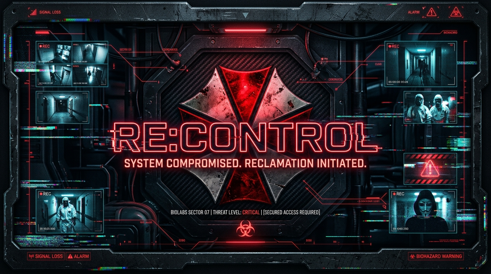
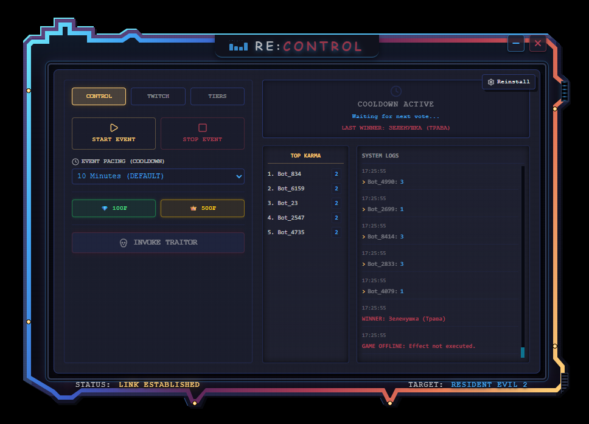
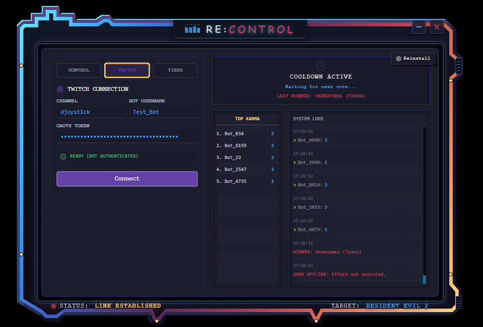
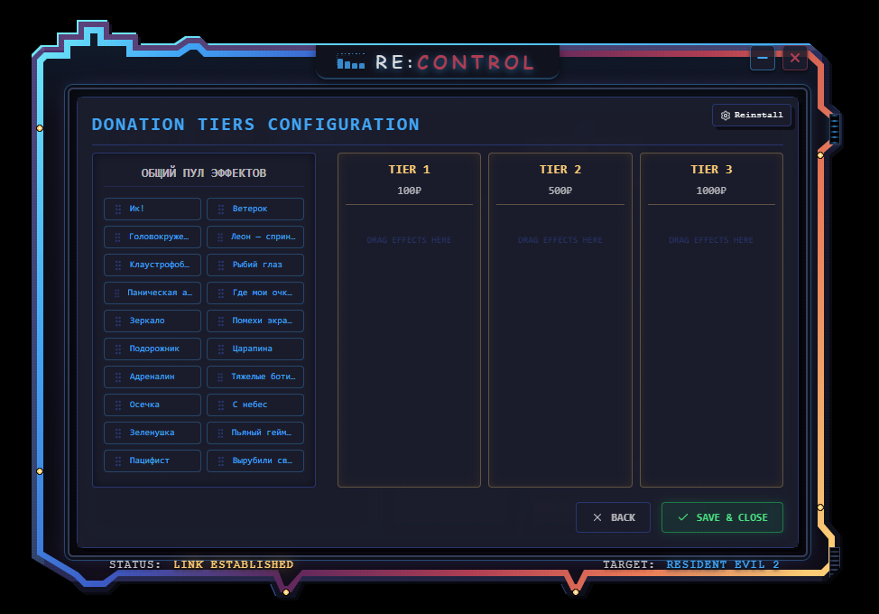
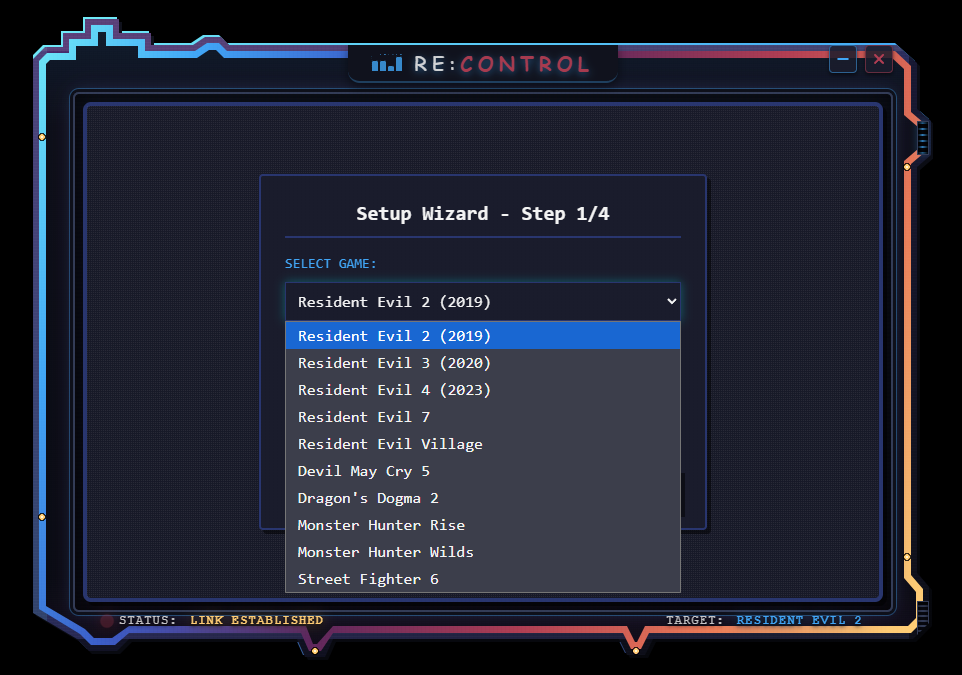

<div align="center">
  

  <p><strong>Интерактивная Twitch-интеграция нового поколения для Resident Evil</strong></p>
  <p><em>Превратите зрителей в режиссёров хаоса. Управляемого хаоса — как и подобает корпорации Umbrella.</em></p>

  []()
  []()
  []()
  []()
  []()
  []()
</div>

<br/>

**RE:CONTROL** — это Electron-приложение, которое связывает Twitch-чат трансляции с движком Resident Evil через REFramework. Зрители голосуют, донатят и применяют десятки эффектов прямо в игре в реальном времени.

---

##  Скриншоты

| Панель управления | Настройка Twitch |
| :---: | :---: |
|  |  |

| Конфигуратор эффектов (Tiers) | Мастер установки |
| :---: | :---: |
|  |  |

---

##  Все механики

###  Система Голосований

Каждые N минут автоматически запускается 30-секундное голосование. Из 22 доступных эффектов случайно выбираются **ровно 3** — по одному из каждой категории:

| Категория | Пример эффектов |
|-----------|-----------------|
|  Положительные | Лёгкое лечение, Пополнение патронов, Добавить леи |
|  Отрицательные | Выбить оружие, Статический разряд, Оттолкнуть назад |
|  Психологические | Спин на 180°, Призрачный крик, Ослепление, Инвертированные контроли |

Зрители голосуют, набирая `1`, `2` или `3` в чате. Победивший эффект применяется к Леону по UDP мосту (REFramework).

---

###  Движок Вмешательств Амбреллы (Intervention Engine)

На 15-й секунде каждого голосования (ровно на экваторе) бросается кубик с шансом **30%**. Если прокнул — выбирается одно случайное вмешательство из пула:

| Вмешательство | Что происходит |
|---------------|----------------|
|  **Вето Амбреллы** | Лидирующая опция мгновенно удаляется из голосования |
|  **Инверсия** | Голоса лидера (1 место) и аутсайдера (3 место) меняются местами |
|  **Слепая зона** | Полоски прогресса и проценты скрываются, зрители голосуют вслепую |
|  **Уравнитель** | Голоса всех опций обнуляются до среднего значения — гонка начинается заново |
|  **Режим Турбо** | Таймер голосования обрезается до 5 секунд — надо срочно выбирать |

Вмешательство немедленно транслируется в Twitch-чат и в OBS-оверлей зрителей.

---

###  Режим Предателя (Traitor Mode)

Эксклюзивная механика для VIP-зрителей, подписчиков и модераторов.

- Стример нажимает кнопку **INVOKE TRAITOR** в панели управления
- Система сканирует последних активных зрителей с доверенным статусом (VIP / Sub / Mod)
- Случайный зритель из пула получает **единоличный контроль** над следующим эффектом
- Во время Traitor Mode обычное голосование приостановлено — **Предатель** выбирает сам
- В чат отправляется объявление: кто именно стал Предателем

> **Безопасность:** рандомный зритель из общего чата стать Предателем **не может** — только доверенные пользователи.

---

###  Интеграция Донатов (DonationAlerts)

| Сумма | Что происходит |
|-------|----------------|
| 100₽ | Случайный эффект из общего пула применяется вне очереди |
| 300₽ | **Внеочередное голосование** — текущее прерывается, сразу запускается новое |
| 500₽ | VIP-эффект — случайный эффект из премиум-пула |

---

###  Система MEGA-эффектов

Если во время голосования 5 зрителей **подряд** (без перебивания другими номерами) голосуют за одну и ту же опцию, она получает статус **MEGA**. При победе в игру отправляется усиленная версия эффекта (`MEGA_[effectId]`), которая в Lua-скрипте активирует хардкорный вариант.

> Например: обычный `light_heal` лечит на 15%, `MEGA_light_heal` — на 30-35%.

---

###  Голосовой Нарратор (Реальные актеры)

Холодный корпоративный голос от лица Umbrella Corporation и голос выжившего Союзника по рации. Озвучка была записана с реальными актерами и подобрана под каждый сценарий индивидуально.

**Триггеры:**
- Срабатывание любого Вмешательства (Вето, Инверсия, Слепая зона, Паритет, Турбо)
- Активация режима Предателя
- Победа отрицательного эффекта (Уведомление от Амбреллы)
- Победа положительного эффекта (Сообщение от Союзника)

**Стек:**
- Формат: `.ogg` (базируется в папке `assets/voice_acting`)
- Строгая фильтрация файлов по префиксам (например `veto_`, `pos_`, `neg_`)
- Воспроизведение происходит прямо внутри OBS Оверлея (HTML5 Audio), что устраняет рассинхрон звука на стриме и не требует сторонних микшеров.

---

###  OBS-Оверлей для зрителей

Локальный WebSocket сервер (`ws://localhost:27016`) транслирует все события в браузер-оверлей. В OBS добавляется как **Browser Source** на `http://localhost:5174/overlay.html`.

**Что видят зрители:**
- Полосы прогресса голосования в реальном времени с анимацией
- Красный глитч-баннер при срабатывании Вмешательства (пульсирует 8 секунд)
- Режим слепой зоны: прогресс скрыт, показывается `???`
- Анимированное уведомление об активном эффекте
- **Крупные аркадные субтитры:** Динамически меняют дизайн (темно-красные рамки для Амбреллы, неоново-синие для Союзника).
- **Синхронный звук:** Все звуки диктора играются прямо внутри оверлея.

---

###  Система Кармы и Лидерборд

Встроенная SQLite база данных отслеживает активность каждого зрителя:
- Голосование за положительный эффект → +1 карма
- Голосование за отрицательный/психологический → -1 карма
- Топ зрителей отображается в панели управления (лидерборд)

---

###  Панель Управления и Настройки

Программа имеет продуманный React-интерфейс, разбитый на смысловые вкладки:
- **CONTROL:** Главный рабочий стол стримера (запуск, таймеры, статистика, логи).
- **TWITCH:** Подключение и авторизация бота.
- **TIERS:** Полноэкранный Drag-and-Drop редактор. Перетаскивание эффектов между тирами (Tier 1, Tier 2, Tier 3). Настройка цен за каждый Тир с глобальным селектором валют (₽, $, €, ₴, ₸) с защитой от ввода текста.
- **DEBUG:** Изолированная среда для тестов. Встроенный симулятор Twitch-аудитории, модальное окно тестирования голосов (Soundboard) и триггеры игровых событий без реального стрима.

---

###  Пульт управления на смартфоне (Web Remote / Stream Deck)

Для удобного тестирования и управления во время стрима без сворачивания игры (Alt+Tab ставит Resident Evil на паузу) разработан мобильный веб-пульт:

- **Как это работает:** Приложение поднимает локальный HTTP-сервер на порту `27016` и автоматически генерирует персональную ссылку и QR-код для локальной сети (`http://<LAN_IP>:27016/remote`).
- **Stream Deck под рукой:** Телефон лежит рядом с клавиатурой/геймпадом. Стример играет двумя руками, а пальцем нажимает на экран смартфона — эффект моментально активируется в игре.
- **Интерактивные плитки:** Крупные touch-карточки с тактильной подсветкой и toast-уведомлениями, сгруппированные по цветам:
  -  **Вредительство:** Осечка, Подскок, Ветерок, Разворот 180°, Инверт, Слепота, Помехи VHS, Замедление, Царапина, Удар ножом, Клаустрофобия, Рыбий глаз, Заморозка, Скример.
  -  **Помощь:** Подорожник (+15% HP), Спрей (100% HP), Боекомплект, Безлимитные патроны (15с), Адреналин, Подарочек.
  -  **Амбрелла / Спавн:** Зомби, Лизун, Цербер, Шаги Мистера X.
- **Быстрые действия:** Мгновенный принудительный запуск голосования или активация Вмешательства Амбреллы прямо с телефона.

---

###  Нативная интеграция с RE Engine (Resident Evil 2 Remake)

Логика моста `effects.lua` полностью переведена на реальные низкоуровневые классы и синглтоны движка Capcom RE Engine через REFramework:

- **Здоровье и урон (`app.ropeway.HitPointController`):**
  - Прямой контроль реального пула жизней Леона (1200 HP).
  - Эффекты полного/малого хила и честного урона (50%, царапины) без псевдокода.
- **Патроны и обойма (`app.ropeway.inventory.Slot`):**
  - **Осечка:** считывает патроны из магазина, перекладывает их в реальную пачку инвентаря Леона (`inv:get_Slots()`) и опустошает магазин. Игрок слышит щелчок "пусто", но его патроны не сгорают безвозвратно!
  - **Боекомплект и Безлимит:** моментальное наполнение обоймы до максимума и покадровое удержание патронов в течение 15 секунд.
- **Физика и координаты (`via.Transform`):**
  - **Разворот на 180°:** математически точный разворот ориентации по кватернионам вокруг оси Y синхронно с разворотом камеры игрока.
  - **Подскок (`hop`):** подбрасывание персонажа вверх на 1.8м с гарантированным таймером плавного приземления на пол.
  - **Ветерок (`push_back`):** физический отброс персонажа назад по вектору направления взгляда.
- **Рендер и эффекты экрана (`draw.filled_rect`):**
  - Нативное закрашивание экрана для Слепоты (Blackout) и генерация динамических помех старого кинескопа (VHS).
- **Камера и атмосфера (`app.ropeway.camera.CameraSystem`):**
  - Скример и тяжелая поступь шагов Тирана (Мистер X), пьяное покачивание прицела.

---

###  Симулятор Чата и Вкладка «ТЕСТЫ»

Вкладка «ТЕСТЫ» полностью переработана для идеальной эргономики:
- **Полное отсутствие скроллбаров:** Чат и лидерборд кармы изолированы на вкладке «ПУЛЬТ».
- **Интегрированный Stream Deck блок:** QR-код для подключения смартфона, прямая кнопка открытия пульта в браузере и сетка быстрого прямого запуска эффектов.
- **Симулятор ботов:** Автоматические зрители, тестовые донаты (300₽, 500₽), принудительный старт раундов.

---

##  Дорожная карта

- [x] **Фаза 1:** MVP — мост с игрой, базовый UI, парсинг Twitch
- [x] **Фаза 2:** Расширение — Карма, Предатель, 22 эффекта, Twitch Bot OAuth
- [x] **Фаза 3.2:** OBS-оверлей (React Browser Source + WebSocket)
- [x] **Фаза 3.3:** Интеграция DonationAlerts (приоритетная очередь)
- [x] **Фаза 3.5:** Конфигуратор тиров (Drag-and-Drop, тултипы)
- [x] **Фаза 3.6:** Внеочередное голосование за донат 300₽
- [x] **Фаза 4.1:** Система MEGA-эффектов (цепные комбо x5)
- [x] **Фаза 4.1b:** Движок Вмешательств Амбреллы (5 типов, 30% шанс)
- [x] **Фаза 4.2:** Озвучка реальными актерами (.ogg файлы с разделением на Амбреллу и Рацию)
- [x] **Фаза 4.3:** Аудио-движок внутри OBS Оверлея и динамические субтитры
- [x] **Фаза 4.4:** Рефакторинг UI (вкладка Debug, редактируемые донаты и валюты)
- [x] **Фаза 4.5:** Web Remote Stream Deck для смартфона и редизайн вкладки «ТЕСТЫ» (Zero-Scroll)
- [x] **Фаза 4.6:** Реверс-инжиниринг RE Engine (нативные эффекты здоровья, патронов, физики и рендера)
- [ ] **Фаза 5:** Реальное подключение DonationAlerts / Streamlabs по токену
- [ ] **Фаза 6:** Мульти-игровые профили (RE4 Remake / RE3 Remake)
- [ ] **Фаза 7:** Инсталлятор (Packaging в .exe файл) и Публичное API

---

##  Технический стек

| Слой | Технологии |
|------|------------|
| Фронтенд | React 18, TypeScript, TailwindCSS, Framer Motion |
| Бэкенд | Electron (Node.js), Express/HTTP Server, WebSocket (ws) |
| Мобильный пульт | Web Remote (HTML5, Touch API, QR-code) на порту 27016 |
| База данных | SQLite (better-sqlite3) |
| TTS / Озвучка | Реальные актёры озвучки + Edge Neural TTS (`ru-RU-DmitryNeural`) |
| Игровой мост | REFramework Lua, Capcom RE Engine IPC |
| OBS интеграция | WebSocket Server на порту 27016, Browser Source |

---

##  Установка и запуск

### Требования
- Node.js 18+
- Resident Evil 2 Remake с установленным REFramework

### Шаги

```bash
# 1. Клонируй репозиторий
git clone https://github.com/Djoystick/RE-Control.git
cd RE-Control

# 2. Установи зависимости Node.js
npm install

# 3. Запусти в режиме разработки
npm run dev
```

### Мобильный пульт (Stream Deck)
- Открой вкладку **«ТЕСТЫ»** в приложении.
- Наведи камеру смартфона на QR-код или перейди в браузере телефона по адресу `http://<IP_компьютера>:27016/remote`.

### OBS-оверлей
Добавь в OBS новый источник **Browser Source**:
- URL: `http://localhost:5174/overlay.html`
- Ширина: `1920`, Высота: `1080`

---

##  Лицензия

Создано **Djoystick**. Для личного и некоммерческого использования.

